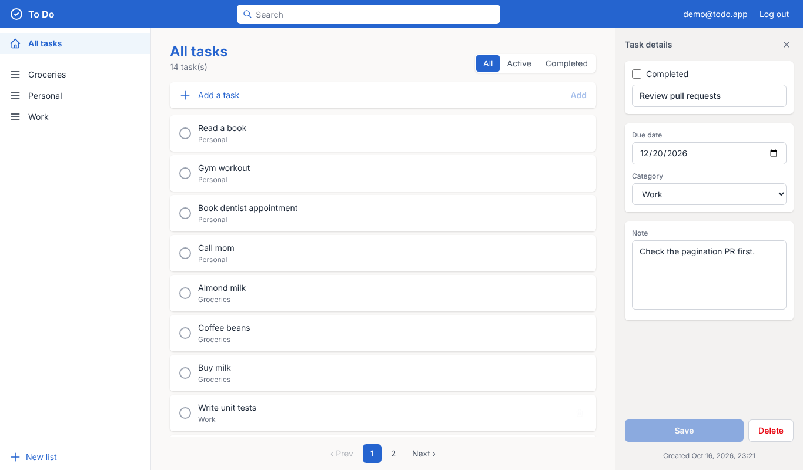
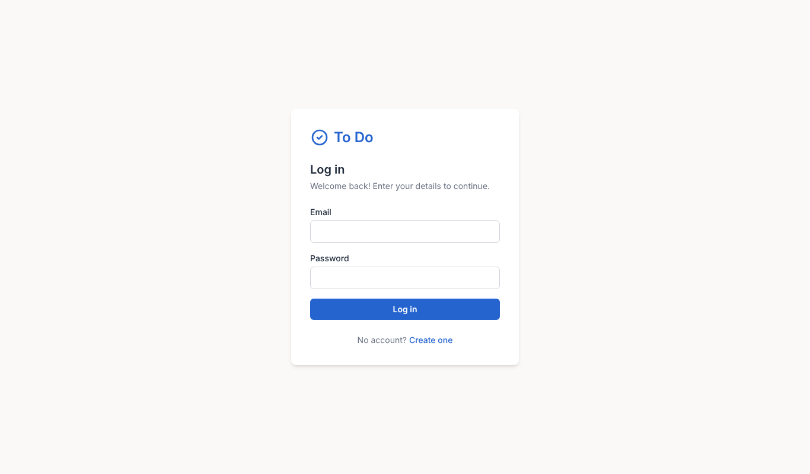
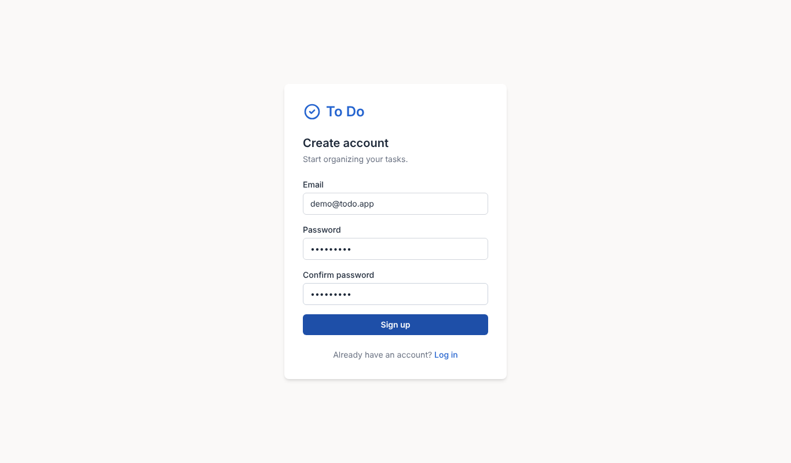
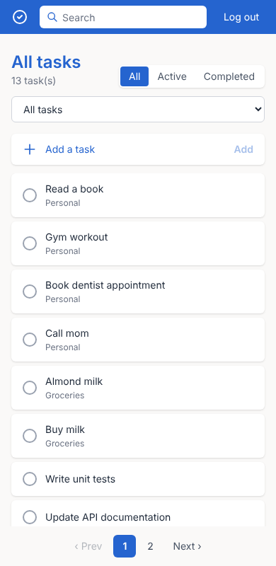

# To Do: a Microsoft To-Do style application

A full-stack To-Do application built as a test assignment:
**ASP.NET Core Web API (.NET 10) + EF Core + MS SQL Server** on the backend and **Angular 22 + Tailwind CSS** on the frontend.



## Features

- **Tasks:** create, view, edit, delete; mark as completed; due date and note
- **Categories** (lists): create, rename, delete. Deleting a category keeps its tasks.
- **Authentication:** sign up, log in, log out (JWT). Every user sees only their own data.
- **Pagination** of the task list (server-side)
- **Search** by title and description, **filter** by category and status (all / active / completed)
- Validation on both client and server, consistent error responses
- Swagger UI with JWT authorization
- Responsive Microsoft To-Do–like UI

## Tech stack

| Layer | Technologies |
|---|---|
| Backend | .NET 10, ASP.NET Core Web API (controllers), EF Core 10, MS SQL Server 2022 |
| Auth | JWT Bearer (`Microsoft.AspNetCore.Authentication.JwtBearer`), BCrypt password hashing (`BCrypt.Net-Next`) |
| API docs | Swagger / OpenAPI (`Swashbuckle.AspNetCore`) |
| Frontend | Angular 22 (standalone components, signals, reactive forms, HttpClient, interceptor, guards), Tailwind CSS 4 |
| Infrastructure | Docker Compose (SQL Server) |

## Architecture

The backend follows a **4-layer architecture**. Each layer is a separate project:

| Project | Responsibility |
|---|---|
| `TodoApp.Api` | Controllers, `Program.cs`, configuration, middleware. Composition root (DI registration). |
| `TodoApp.Services` | Business logic: implementations of service interfaces. |
| `TodoApp.Interfaces` | Contracts: service and repository interfaces, DTOs, entities, custom exceptions, options. |
| `TodoApp.DataAccess` | EF Core `DbContext`, entity configurations, migrations, repository implementations. |

### Project dependencies

```
                 ┌───────────────────┐
                 │    TodoApp.Api    │
                 │ (composition root)│
                 └──┬─────────────┬──┘
                    │             │
                    ▼             ▼
       ┌────────────────┐   ┌────────────────────┐
       │TodoApp.Services│   │ TodoApp.DataAccess │
       │ business logic │   │ EF Core, SQL Server│
       └───────┬────────┘   └─────────┬──────────┘
               │                      │
               ▼                      ▼
             ┌──────────────────────────┐
             │    TodoApp.Interfaces    │
             │ interfaces, DTOs, entities│
             │  (depends on nothing)    │
             └──────────────────────────┘
```

All arrows point **towards `TodoApp.Interfaces`** (Dependency Inversion Principle):

- `Services` depends only on abstractions (`ITaskRepository`, ...) and knows nothing about EF Core or SQL.
- `DataAccess` implements the repository interfaces declared in `Interfaces`.
- `Api` references everything only to wire implementations into the DI container.
- There are no circular references, and the compiler enforces this.

### How a request flows through the layers

`PUT /api/tasks/5` with a JWT:

```
Angular TaskService ──HTTP + "Authorization: Bearer <jwt>" (added by authInterceptor)──▶
  ExceptionHandlingMiddleware          (wraps everything in try/catch)
  → CORS → Authentication              (validates JWT signature, issuer, audience, expiry)
  → Authorization                      ([Authorize] → 401 if no valid token)
  → TasksController.Update             (model binding + DataAnnotations validation → 400)
      userId = User.GetUserId()        (from the "sub" claim)
  → ITaskService → TaskService.UpdateAsync
      checks the task belongs to the user (else NotFoundException → 404)
      checks the category belongs to the user (else BadRequestException → 400)
  → ITaskRepository → TaskRepository   (EF Core: SELECT ... WHERE Id = 5 AND UserId = @userId)
  → SaveChangesAsync                   (UPDATE Tasks SET ...)
  ◀── TodoItem entity → TaskDto (manual mapping) → 200 OK JSON
```

## API

| Method | Endpoint | Description | Auth |
|---|---|---|---|
| POST | `/api/auth/register` | Create account, returns JWT | — |
| POST | `/api/auth/login` | Log in, returns JWT | — |
| GET | `/api/categories` | List of the user's categories | ✔ |
| GET | `/api/categories/{id}` | One category | ✔ |
| POST | `/api/categories` | Create category | ✔ |
| PUT | `/api/categories/{id}` | Rename category | ✔ |
| DELETE | `/api/categories/{id}` | Delete category (tasks are kept) | ✔ |
| GET | `/api/tasks?page=1&pageSize=10&search=&categoryId=&isCompleted=` | Paged, filtered list | ✔ |
| GET | `/api/tasks/{id}` | One task | ✔ |
| POST | `/api/tasks` | Create task | ✔ |
| PUT | `/api/tasks/{id}` | Update task | ✔ |
| DELETE | `/api/tasks/{id}` | Delete task | ✔ |

Paged response: `{ "items": [...], "totalCount": 14, "page": 1, "pageSize": 10, "totalPages": 2 }`

Errors use the standard **ProblemDetails** format: `{ "title": "Not found", "status": 404, "detail": "Task with id 5 was not found." }`.
Status codes: `200`, `201` (create), `204` (delete), `400` (validation), `401` (no/invalid token or wrong password), `404`, `409` (duplicate email/category), `500`.

## Getting started

### Prerequisites

- [Docker Desktop](https://www.docker.com/products/docker-desktop/)
- [.NET 10 SDK](https://dotnet.microsoft.com/download/dotnet/10.0)
- [Node.js](https://nodejs.org/) 22.22+ or 24+ (required by Angular CLI 22)

### 1. Start the database

```bash
docker compose up -d
```

SQL Server 2022 runs on `localhost:1433`. Wait ~20 seconds for the first start.

### 2. Start the API

```bash
cd server
dotnet run --project TodoApp.Api
```

- The database and tables are created automatically on startup (EF Core migrations are applied in Development).
- API: http://localhost:5000
- Swagger UI: http://localhost:5000/swagger. Call `/api/auth/register` or `/api/auth/login`, copy the `token`, click **Authorize** and paste it.

### 3. Start the Angular app

```bash
cd client
npm install
npm start
```

Open http://localhost:4200, create an account and start adding tasks.

### Useful commands

```bash
# Create a new migration (from the server folder)
dotnet tool restore
dotnet ef migrations add <Name> --project TodoApp.DataAccess --startup-project TodoApp.Api

# Reset the database (deletes all data)
docker compose down -v
```

## Project structure

```
├── docker-compose.yml            # MS SQL Server
├── server/
│   ├── TodoApp.Api/              # Controllers, Middleware, Extensions, Program.cs
│   ├── TodoApp.Services/         # AuthService, TokenService, TaskService, CategoryService, Mapping
│   ├── TodoApp.Interfaces/       # Entities, DTOs, Repositories & Services interfaces, Exceptions, Options
│   └── TodoApp.DataAccess/       # AppDbContext, Configurations, Repositories, Migrations
├── client/src/app/
│   ├── core/                     # models, services (HttpClient), interceptors, guards, utils
│   ├── features/
│   │   ├── auth/                 # login-page, register-page
│   │   ├── tasks/                # tasks-page, task-item, task-details
│   │   └── categories/           # category-sidebar
│   └── shared/components/        # pagination
└── docs/
    ├── LEARNING.md               # study notes (in Russian)
    └── screenshots/
```

## Design decisions

- **Entities live in `TodoApp.Interfaces`.** Repository interfaces return entities. If entities lived in `DataAccess`, `Interfaces` and `DataAccess` would reference each other (a circular reference).
- **Custom JWT authentication without ASP.NET Identity.** A simple `User` entity plus BCrypt. It's easy to see and explain every step.
- **JWT is stateless.** Logout on the client simply removes the token. Trade-off: a token can't be revoked before it expires, so the lifetime is kept short (60 minutes). A production system would add refresh tokens and/or a token blacklist.
- **Another user's data returns 404, not 403**, so the API doesn't reveal that a resource exists.
- **Deleting a category keeps its tasks** (`CategoryId` becomes `null`). SQL Server doesn't allow `ON DELETE SET NULL` here because of multiple cascade paths, so EF Core does it (`ClientSetNull`).
- **Manual mapping** entity → DTO instead of AutoMapper. It's explicit and easy to debug.
- **No state management library** on the frontend. Angular signals and services are enough for an app of this size.

## Security notes

The SQL Server password and the JWT signing key in `docker-compose.yml` / `appsettings.Development.json` are **for local development only**.
In production they must come from environment variables or a secret store (e.g. Azure Key Vault), and the API must run over HTTPS.

## Screenshots

| Login | Sign up | Mobile |
|---|---|---|
|  |  |  |
